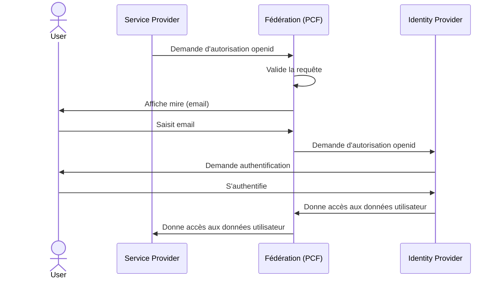

# Documentation ProConnect Fédération

D'un point de vue technique. La cinématique ProConnect Fédération (PCF) est divisée en deux parties principales distinctes:

1. Un échange openid entre le FI et PCF
2. Un échange openid entre PCF et le FS

Ces deux échanges ne sont cependant pas linéaires:

1. Le FS effectue une [demande d'autorisation openid](https://openid.net/specs/openid-connect-core-1_0.html#AuthorizationEndpoint) au endpoint PCF dédié. **# Début de l'échange entre le FC et le FS**
2. PCF valide que la requête est acceptable et affiche une mire où l'user doit entrer son email.
3. Le FI est automatiquement choisi selon l'email de l'user puis FC effectue une [demande d'autorisation openid](https://openid.net/specs/openid-connect-core-1_0.html#AuthorizationEndpoint) à l'endpoint dédié de ce FI. **# Début de l'échange entre le FI et PCF**
4. L'utilisateur s'authentifie sur le FI.
5. Le FI donne accès aux données de l'utilisateur à PCF. **# Fin de l'échange entre le FI et PCF**
6. PCF donne accès aux données de l'utilisateur au FS. **# fin de l'échange entre PCF et FS**

L'échange entre le FI et PCF est encapsulé dans l'échange entre PCF et le FS. Il faut garder en tête que cette représentation reste simplifiée car il existe en vérité d'autres étapes qui s'insèrent entre ces étapes. On garde cependant une bonne vision globale de ce qu'il se passe.

# Mode maintenance

Pour activer le mode maintenance, définir `App_MAINTENANCE_MODE=true` et redémarrer l'application. La page de maintenance remplace l'application, mais le document de découverte OIDC et les routes d'observabilité (/healtz et /readiness) restent disponibles. La configuration habituelle reste requise.

Pour personnaliser la page, définir éventuellement :

- `App_MAINTENANCE_DATETIME` : date ou période de la maintenance.
- `App_MAINTENANCE_DURATION` : durée d'indisponibilité annoncée.

Pour désactiver le mode maintenance, supprimer `App_MAINTENANCE_MODE` ou le définir à `false`, puis redémarrer l'application.

# Bandeau de maintenance programmée

Pour prévenir les utilisateurs d'une opération de maintenance sur la page de connexion, définir les variables suivantes et redémarrer l'application :

- `App_FEATURE_DISPLAY_MAINTENANCE_NOTICE=true` : affiche le bandeau.
- `App_MAINTENANCE_NOTICE_DATETIME` : date ou période de la maintenance.
- `App_MAINTENANCE_NOTICE_DURATION` : durée approximative d'indisponibilité.

Pour masquer le bandeau, supprimer `App_FEATURE_DISPLAY_MAINTENANCE_NOTICE` ou le définir à `false`, puis redémarrer l'application.

# Codes erreurs des applications

Cette section fait le lien avec les codes erreurs des applications.

Voir [erreurs](_doc/erreurs.md).
